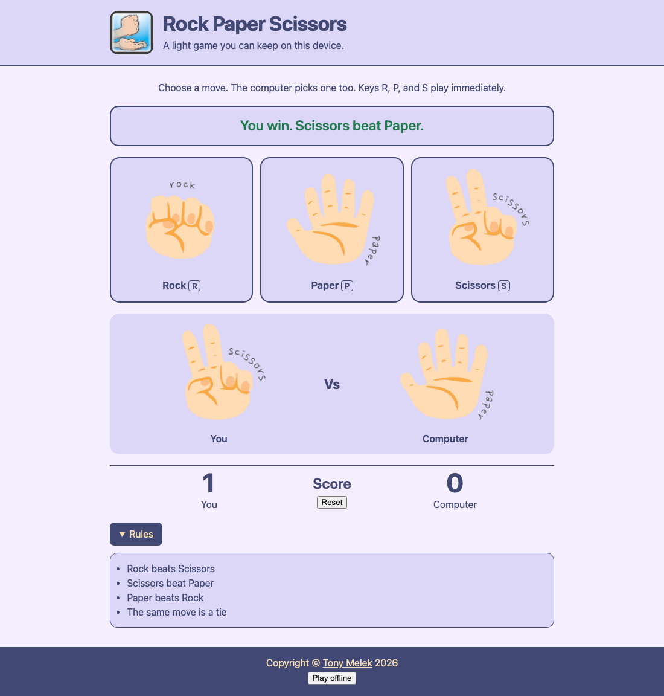

# Rock Paper Scissors

A small rock-paper-scissors game. It runs in the browser, remembers the score on this device, and can be saved for offline play.

## Play

Choose Rock, Paper, or Scissors. The computer picks a move, the result is announced, and the score updates.

- Rock beats Scissors
- Scissors beat Paper
- Paper beats Rock
- The same move is a tie

Keys **R**, **P**, and **S** play those moves. **Reset** clears the score and the last round.

You can try the hosted copy at [Rock Paper Scissors](https://tonymelek.github.io/rock_paper_scissors/).



## Install and play offline

The page is a progressive web app. The service worker stores the HTML, CSS, JavaScript, images, and icons after one successful load. Later visits use that copy when the network is off.

Desktop Chrome and Edge show a **Play offline** button when they can install the app. You can also use the browser’s install or “Add to Home Screen” control.

On iPhone or iPad, open the page in Safari, tap **Share**, then **Add to Home Screen**.

Opening `index.html` as a file will not register the service worker. Use a local static server, or the GitHub Pages URL.

During local work, Chrome DevTools → Application → Service Workers → **Bypass for network** avoids a stuck cache. When a static file changes, bump `CACHE` in `sw.js` so the next visit drops the old copy. Reload twice online to see the update: the first reload refreshes the cache, the second uses it.

## Develop

Requirements: Node.js 22 or newer.

```bash
npm install
npm test
npm run build:css
npm run watch:css
```

`css/input.css` is the stylesheet you edit. `npm run build:css` minifies it with Lightning CSS and writes `css/app.css`. That built file is committed, and it is the file the page and the service worker load. `npm run watch:css` rebuilds it when the source changes.

Serve the folder over HTTP before checking offline behavior:

```bash
python3 -m http.server 8080
```

Then open `http://127.0.0.1:8080/`.

## Project layout

| Path | Role |
| --- | --- |
| `index.html` | Page |
| `css/input.css` | Stylesheet source |
| `css/app.css` | Minified stylesheet, committed |
| `js/game.js` | Rules, with no DOM |
| `js/app.js` | Page behavior, score storage, service worker registration |
| `sw.js` | Offline cache |
| `manifest.webmanifest` | Install metadata |
| `icons/` | Home-screen icons |

## Feedback

Comments are welcome at [tonymelek.au@gmail.com](mailto:tonymelek.au@gmail.com).

## License

Copyright © Tony Melek 2026
